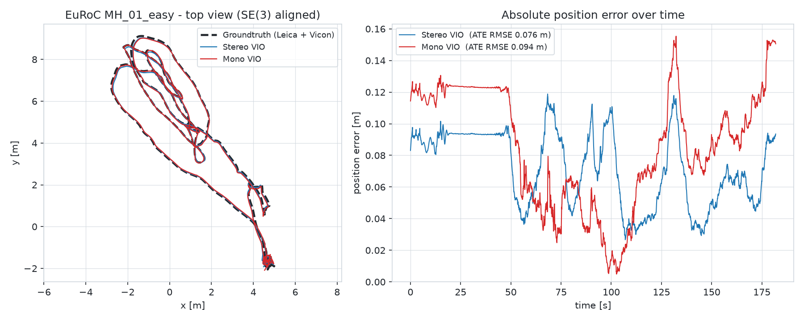
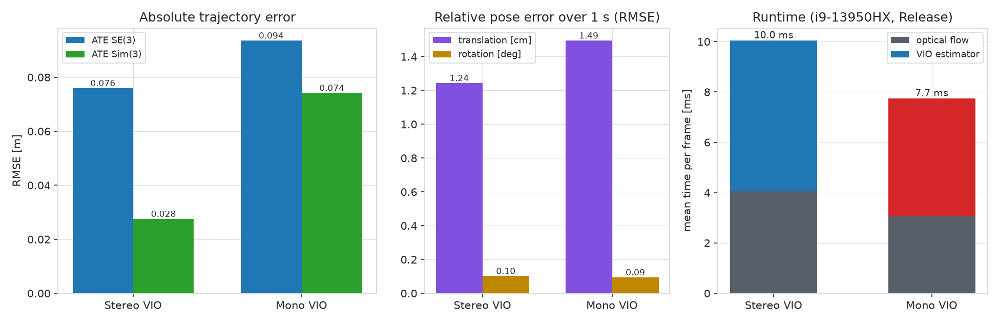

# basalt-standalone

[](LICENSE)    

**[Basalt](https://gitlab.com/VladyslavUsenko/basalt) visual-inertial odometry as a small standalone C++17 program — only Eigen and OpenCV, no ROS, no Linux.**

Basalt (TUM Computer Vision Group) is one of the most accurate open-source stereo VIO systems, but it targets Linux and pulls in a large dependency stack (Pangolin, TBB, Sophus, CLI11, magic_enum, …). This repository is a compact C++17 port of Basalt's VIO pipeline — frame-to-frame patch optical flow, IMU preintegration and the sliding-window keypoint estimator with marginalization — that depends only on **Eigen** and **OpenCV**, builds with **Visual Studio 2022 (MSVC) + vcpkg** in about a minute and runs on EuRoC data directly from disk. It adds an ATE/RPE evaluation and a self-contained HTML report per run. The executables keep the prefix `bw_` from the project's working name, *Basalt-Win*.

| Basalt | This repo | What it does |
|---|---|---|
| `basalt_vio` (+ Pangolin GUI) | `bw_vio.exe` | Stereo or mono VIO on an EuRoC/ASL folder; trajectory, metrics, HTML/Markdown report |
| `FrameToFrameOpticalFlow`, `OpticalFlowPatch`, `Pattern51` | `src/optical_flow.cpp` | SE(2) inverse-compositional patch tracking on an image pyramid, forward/backward check, FAST per 50 px cell, stereo matching with epipolar check |
| `IntegratedImuMeasurement` | `src/imu.cpp` | IMU preintegration with bias Jacobians and covariance |
| `SqrtKeypointVioEstimator` | `src/vio_estimator.cpp` | 3 states + 7 keyframes, inverse-distance landmarks, Huber reprojection, IMU and bias random-walk factors, Levenberg–Marquardt, Schur complement, marginalization |
| Double Sphere camera, `euroc_config.json`, `euroc_ds_calib.json` | `include/bw/camera.h`, `config/*.txt` | Same camera model and the same parameter values |
| ATE evaluation in `basalt_vio` | `bw_eval.exe`, `src/eval.cpp`, `src/report.cpp` | ATE (SE(3) / Sim(3) Umeyama) and RPE over 1 s for any TUM trajectory |

Headline result on **EuRoC MH_01_easy**: stereo VIO reaches an ATE RMSE of **0.076 m** (Basalt paper: 0.07 m), mono VIO **0.094 m**, at **10 ms per stereo frame** on a laptop CPU — and the results are deterministic, bit-for-bit identical between runs. Full numbers are [below](#results-on-euroc-mh_01).

<picture>
  <source media="(prefers-color-scheme: dark)" srcset="docs/images/mh01_trajectory_dark.png">
  
</picture>

---

## Contents

- [Repository layout](#repository-layout)
- [Dependencies](#dependencies)
- [Build](#build)
- [Dataset](#dataset)
- [Usage](#usage)
- [Results on EuRoC MH_01](#results-on-euroc-mh_01)
- [Differences from the original Basalt](#differences-from-the-original-basalt)
- [Acknowledgements and license](#acknowledgements-and-license)

## Repository layout

```
basalt-standalone/
├── CMakeLists.txt, CMakePresets.json   # plain CMake, preset "msvc-vcpkg"
├── include/bw/              # headers: lie (SO3/SE3), camera, config, dataset, optical_flow,
│                            #          imu, vio_estimator, eval, report
├── src/
│   ├── optical_flow.cpp, imu.cpp, vio_estimator.cpp   # the VIO pipeline
│   ├── dataset.cpp, config.cpp, eval.cpp, report.cpp  # I/O, evaluation, HTML report
│   ├── main_vio.cpp         # bw_vio   - runs VIO on a EuRoC sequence
│   ├── main_eval.cpp        # bw_eval  - evaluates any TUM trajectory against EuRoC groundtruth
│   └── tests.cpp            # bw_tests - numerical Jacobian checks
├── config/                  # euroc_config.txt, euroc_ds_calib.txt (values from Basalt)
├── scripts/
│   ├── setup_vcpkg.ps1      # installs Eigen + OpenCV with vcpkg
│   ├── build.ps1            # configures, builds and runs the unit tests
│   ├── run_euroc.ps1        # runs stereo or mono VIO on one EuRoC sequence
│   └── make_readme_figure.py
├── docs/images/             # README figures
├── results/                 # reference runs on MH_01 (trajectory, metrics, reports) + groundtruth
└── .vscode/                 # build tasks and launch configurations for VS Code
```

`dataset/` (EuRoC data), `build/` and `tools/vcpkg/` (an optional private vcpkg) are created locally and are not part of the repository.

## Dependencies

| Dependency | Used for | Version tested |
|---|---|---|
| Visual Studio 2022 or Build Tools 2022 (MSVC v143, "Desktop development with C++") | C++17 compiler, OpenMP | MSVC 14.44 |
| CMake | build system (presets need ≥ 3.21) | 4.3 |
| Git | cloning this repository and vcpkg | – |
| [vcpkg](https://github.com/microsoft/vcpkg) `eigen3` (triplet `x64-windows`) | linear algebra | 5.0.1 (3.4 also fine) |
| vcpkg `opencv4` | image I/O, pyramids, FAST | 4.12 |

Not needed: ROS, Pangolin, TBB, Sophus, Ceres, Boost, Python (except for the optional figure script), WSL or Linux.

### Install the dependencies

1. Install **Visual Studio 2022** (Community or Build Tools) with the *Desktop development with C++* workload, **CMake** ≥ 3.21 and **Git**.
2. Clone this repository and, from a PowerShell in its root, run:

```powershell
git clone https://github.com/rafal7466/basalt-standalone.git
cd basalt-standalone
powershell -ExecutionPolicy Bypass -File scripts\setup_vcpkg.ps1
```

The script uses your existing vcpkg if `VCPKG_ROOT` points to one; otherwise it clones and bootstraps a private copy into `tools\vcpkg`. It then runs

```powershell
vcpkg install eigen3 opencv4 --triplet x64-windows
```

A first install compiles OpenCV from source and takes roughly 20–40 minutes; if the packages are already installed it finishes in seconds. To use a vcpkg in another location pass `-VcpkgRoot C:\path\to\vcpkg` and set `VCPKG_ROOT` to the same path.

> **Note:** the vcpkg copy that ships with Visual Studio (`…\VC\vcpkg`, set as `VCPKG_ROOT` inside the *Developer PowerShell*) only supports manifest mode and cannot be used here; the script ignores it and uses `tools\vcpkg` instead.

## Build

```powershell
powershell -ExecutionPolicy Bypass -File scripts\build.ps1
```

or manually:

```powershell
cmake --preset msvc-vcpkg                        # Visual Studio 17 2022, x64, vcpkg toolchain
cmake --build build --config Release --parallel
.\build\Release\bw_tests.exe                     # Jacobian unit tests -> ALL TESTS PASSED
```

The build takes about a minute and produces `bw_vio.exe`, `bw_eval.exe` and `bw_tests.exe` in `build\Release\`; vcpkg copies the OpenCV DLLs next to them. `CMakeLists.txt` finds vcpkg through `VCPKG_ROOT`, `tools\vcpkg`, `C:\vcpkg` or `%USERPROFILE%\vcpkg`; you can always override it with `-DCMAKE_TOOLCHAIN_FILE=<vcpkg>\scripts\buildsystems\vcpkg.cmake`. The default configuration and calibration paths are compiled in relative to the source folder, so `bw_vio.exe` finds `config\` without extra options.

**VS Code:** open the folder with the *C/C++* and *CMake Tools* extensions, build with `Ctrl+Shift+B` and start *bw_vio MH_01 (Release)* or the task *Run VIO on EuRoC MH_01*, which expect the data in `dataset\MH_01_easy`.

The code is plain C++17 + CMake and should also build with GCC/Clang on Linux (`libeigen3-dev libopencv-dev`), but only the Windows/MSVC path has been tested.

## Dataset

`bw_vio.exe` reads the **EuRoC / ASL folder format** instead of rosbags:

```
<sequence>/mav0/
├── cam0/data.csv, cam0/data/<timestamp>.png
├── cam1/...
├── imu0/data.csv
└── state_groundtruth_estimate0/data.csv     # optional, used for the evaluation
```

All EuRoC files are hosted on the ETH Research Collection ([doi:10.3929/ethz-b-000690084](https://doi.org/10.3929/ethz-b-000690084), linked from the [EuRoC MAV dataset page](https://projects.asl.ethz.ch/datasets/euroc-mav/)). Download the **Machine Hall** archive (ASL format, not the rosbags), extract `MH_01_easy` into `dataset/` and extract its `.zip` in place if it contains one, so that you get:

```
dataset/MH_01_easy/mav0/{cam0, cam1, imu0, state_groundtruth_estimate0, ...}
```

`--dataset` may point to the folder that contains `mav0/`, to `mav0/` itself, or to a flattened folder with `cam0/ cam1/ imu0/`. Other sequences work the same way; another sensor needs its own calibration file in the format of `config/euroc_ds_calib.txt` (Double Sphere) or `config/test_pinhole_radtan_calib.txt` (pinhole + radial-tangential).

## Usage

### Quick start (PowerShell, EuRoC MH_01)

```powershell
# stereo-inertial odometry (~50 s)
powershell -ExecutionPolicy Bypass -File scripts\run_euroc.ps1 -Dataset dataset\MH_01_easy -Mode stereo

# monocular-inertial odometry (left camera + IMU)
powershell -ExecutionPolicy Bypass -File scripts\run_euroc.ps1 -Dataset dataset\MH_01_easy -Mode mono -Open
```

Each run writes `results\<sequence>_<mode>\` and prints the ATE/RPE summary; `-Open` opens the HTML report afterwards.

### Direct command line

```powershell
.\build\Release\bw_vio.exe --dataset dataset\MH_01_easy --out results\MH_01_easy_stereo
.\build\Release\bw_eval.exe dataset\MH_01_easy\mav0\state_groundtruth_estimate0\data.csv results\MH_01_easy_stereo\trajectory_tum.txt
```

| Option of `bw_vio` | Default | Description |
|---|---|---|
| `--dataset` | – | EuRoC sequence (see [Dataset](#dataset)) |
| `--out` | `results/<name>` | output folder |
| `--name` | folder name of the sequence | name used in the report |
| `--config` | `config/euroc_config.txt` | VIO parameters (`key: value`, same names as Basalt's `euroc_config.json`) |
| `--calib` | `config/euroc_ds_calib.txt` | camera + IMU calibration |
| `--mono` | off | use the left camera only |
| `--max-frames` | all | process only the first N frames |

`bw_eval <groundtruth data.csv> <trajectory_tum.txt>` evaluates any trajectory in TUM format (`t x y z qx qy qz qw`, IMU/body frame) — for example from another VIO system — with the same metrics.

### Outputs (`results/<name>/`)

| File | Content |
|---|---|
| `trajectory_tum.txt` | estimated IMU poses, TUM format `t x y z qx qy qz qw` |
| `metrics.csv` | ATE (SE3 / Sim3), RPE (1 s) and per-stage timing: RMSE, mean, median, std, min, max, count |
| `report.html` | self-contained report with accuracy tables, trajectory / error / bias / timing plots (inline SVG) |
| `report.md` | the same tables in Markdown |
| `frame_stats.csv` | per frame: timing, tracked points, landmarks, keyframes, LM iterations, position, biases |

## Results on EuRoC MH_01

All runs below are stored in [`results/`](results/) together with the groundtruth in TUM format ([`MH_01_groundtruth_tum.txt`](results/MH_01_groundtruth_tum.txt)). They use the default configuration of this repository on the full sequence (3682 stereo frames, 181.8 s, 80.5 m), Release build, Intel i9-13950HX.

<picture>
  <source media="(prefers-color-scheme: dark)" srcset="docs/images/mh01_metrics_dark.png">
  
</picture>

| Configuration | ATE SE(3) | ATE Sim(3) (scale) | RPE 1 s trans. | RPE 1 s rot. | Keyframes | Time / frame (flow + VIO) |
|---|---|---|---|---|---|---|
| Stereo VIO ([report](results/MH_01_stereo/report.md)) | **0.076 m** | 0.028 m (1.017) | 1.24 cm | 0.102° | 461 | 10.0 ms (4.1 + 6.0) |
| Mono VIO ([report](results/MH_01_mono/report.md)) | 0.094 m | 0.074 m (1.013) | 1.49 cm | 0.094° | 472 | 7.7 ms (3.1 + 4.7) |
| Basalt VIO, stereo — paper ([Usenko et al. 2020](https://arxiv.org/abs/1904.06504), Table I) | 0.07 m | – | – | – | – | – |

- ATE is the RMS of the position error after aligning the whole trajectory to the groundtruth (SE(3) = rotation + translation; Sim(3) additionally estimates a scale); RPE compares the relative motion over 1 s windows.
- The stereo result matches the 0.07 m reported for Basalt's VIO in the paper.
- **Deterministic.** Three runs of each configuration gave identical metrics to the last digit; only the timing varies.
- The `report.html` files in `results/` contain the full set of plots (download and open them locally; GitHub shows HTML as source).
- The figures are regenerated from `results/` with `python scripts/make_readme_figure.py` (needs numpy and matplotlib).

## Differences from the original Basalt

- Only the VIO part of Basalt is ported (no mapping / non-linear factor recovery, no calibration tools, no GUI). Input is an EuRoC/ASL folder instead of a rosbag or Basalt's dataset I/O.
- The marginalization prior is re-linearized at the current estimate (no first-estimate Jacobians), and the solver uses the dense Schur complement (Basalt's `SC` linearization) instead of the square-root QR variant.
- Sophus is replaced by the small `include/bw/lie.h`; Pangolin, TBB, CLI11 and the other Basalt dependencies are not needed.
- Additions: monocular mode (`--mono`), a pinhole + radial-tangential camera model, optional gyro-based prediction of the optical flow (`optical_flow_imu_rotation_prediction`, off by default), explicit initial bias priors, optional barometer / airspeed / course factors for fixed-wing aircraft (unused for EuRoC), built-in ATE/RPE evaluation and HTML reports.

## Acknowledgements and license

This repository is released under the [BSD 3-Clause license](LICENSE); attribution of the upstream Basalt code it is derived from, including Basalt's license, is in [NOTICE](NOTICE). To cite it, use GitHub's *Cite this repository* button (generated from [`CITATION.cff`](CITATION.cff)) and please also cite the original Basalt papers listed below.

This work builds directly on **Basalt** by Vladyslav Usenko, Nikolaus Demmel and colleagues at the TUM Computer Vision Group ([gitlab.com/VladyslavUsenko/basalt](https://gitlab.com/VladyslavUsenko/basalt)), distributed under the BSD 3-Clause license. If you use this code in academic work, please cite:

- V. Usenko, N. Demmel, D. Schubert, J. Stückler, D. Cremers, “Visual-Inertial Mapping with Non-Linear Factor Recovery,” IEEE Robotics and Automation Letters, 5(2), 2020.
- V. Usenko, N. Demmel, D. Cremers, “The Double Sphere Camera Model,” 3DV 2018.

EuRoC data: M. Burri et al., “The EuRoC micro aerial vehicle datasets,” IJRR 2016.

Author of the standalone C++ port: **Mohammadreza** ([@rafal7466](https://github.com/rafal7466)), Sharif University of Technology. See also [kalibr-standalone](https://github.com/rafal7466/kalibr-standalone) (Kalibr calibration without ROS) and [svo-pro-standalone](https://github.com/rafal7466/svo-pro-standalone) (SVO Pro without ROS).
